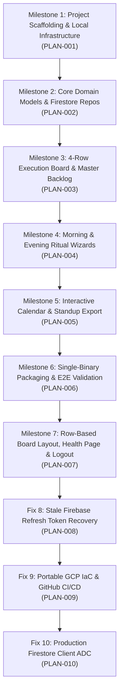

# DailyCheckIn - Milestone Roadmap

## Overview
This roadmap defines the vertical slices and milestone progression for building **DailyCheckIn**, following the 5-agent agile squad lifecycle (`@product-owner` $\rightarrow$ `@ui-designer` / `@devops-engineer` $\rightarrow$ `@developer` $\rightarrow$ `@tester`).

---

## 🗺️ Milestone Progression

---

## Milestone Breakdown

### 🏗️ Milestone 1: Project Scaffolding & Local Infrastructure (PLAN-001)
- **Focus:** Foundational backend (Go 1.23+ Echo), frontend (Vite + React 18 + TS + Tailwind CSS), and Docker-based Firebase emulator infrastructure.
- **Key Artifacts:**
  - `go.mod`, Echo server entrypoint (`cmd/server/main.go`), health check endpoint (`/api/health`).
  - `frontend/` package setup with Tailwind CSS tokens, Lucide icons, TanStack Query, and Vite proxy.
  - `docker-compose.yml` for Firestore (`:8080`), Auth (`:9099`), and Emulator UI (`:4000`).
  - GitHub Actions CI workflow skeleton.
- **Sign-Off:** `go test ./...` and `npm run build` pass; health check verifies backend connectivity.

---

### 📦 Milestone 2: Core Domain Models & Firestore Repositories (PLAN-002)
- **Focus:** Data persistence layer for the core entities defined in `SPECIFICATION.md`.
- **Entities & Collections:**
  - `DaySession` (`/users/{uid}/days/{date}`)
  - Master `Task` (`/users/{uid}/tasks/{taskId}`)
  - Day-Task Association `DayTask` (`/users/{uid}/days/{date}/day_tasks/{taskId}`)
- **Key Deliverables:**
  - Go domain structs, DTOs, Firestore repositories, and composite indexes (`firestore.indexes.json`).
  - Integration tests running against the local Firestore emulator.
- **Sign-Off:** 100% repository unit & emulator integration test pass rate.

---

### 📋 Milestone 3: 4-Row Execution Board & Global Backlog CRUD (PLAN-003)
- **Focus:** The primary daily execution interface with drag-and-drop mechanics.
- **Components & Features:**
  - 4 Execution Rows: **Yesterday** (read-only completed), **Today** (prioritized 1..N), **Blocked** (with blocker reason notes), and **Backlog** (persistent global pool).
  - Drag-and-drop reordering & row transitions (`@hello-pangea/dnd`).
  - Instant checkbox completion toggle with optimistic TanStack Query updates.
  - Quick task creation modal / inline inputs.
- **Sign-Off:** QA validation of drag-and-drop, state updates, and optimistic UI synchronization.

---

### 🌅 Milestone 4: Morning Check-In & End-of-Day Ritual Wizards (PLAN-004)
- **Focus:** The structured morning and evening ritual workflows.
- **Workflows:**
  - **Morning Check-In Wizard:**
    1. Review yesterday's accomplishments.
    2. Rollover incomplete tasks from previous active day into Today or Backlog.
    3. Pull and prioritize items from the Global Backlog.
    4. Commit and stamp `check_in_at`.
  - **End-of-Day Check-Out Wizard:**
    1. Review Today's completed tasks.
    2. Triage incomplete tasks (roll over vs. demote to Backlog).
    3. Daily reflections and notes.
    4. Commit and stamp `check_out_at`.
- **Sign-Off:** Automated Gherkin test suite validating session state transitions.

---

### 📅 Milestone 5: Interactive Calendar & Standup Markdown Export (PLAN-005)
- **Focus:** Temporal navigation, historical day reviews, and standup sharing.
- **Features:**
  - Month-view calendar in top-left with check-in status indicators (completed, incomplete, checked out).
  - Quick date navigation ("Jump to Today", historical read-only day inspection).
  - 1-Click Standup Markdown Generator (formatted for Slack / Teams / Email with Yesterday, Today, Blockers).
- **Sign-Off:** Browser E2E verification of date jumping and clipboard export copying.

---

### 🚀 Milestone 6: Single-Binary Packaging & E2E Validation (PLAN-006)
- **Focus:** Production packaging, multi-stage Docker build, and final QA verification.
- **Deliverables:**
  - Embedded React SPA bundle inside Go binary using `//go:embed` (`bin/dailycheckin`, 19MB).
  - Production multi-stage `Dockerfile` (28.3MB Alpine container with `HEALTHCHECK`) and Google Cloud Run deployment configuration.
  - Automated CI/CD pipeline (`.github/workflows/ci-cd.yml`).
  - Full end-to-end regression test report archived in `test-reports/QA-REPORT-006-final-validation-2026-09-04.md`.
- **Sign-Off:** Standalone single executable and container verified running with 100% test pass rate. Status: **COMPLETE / SIGNED OFF**.

---

### 🎨 Milestone 7: Row-Based Board Layout, Dedicated Health Page & Logout (PLAN-007)
- **Focus:** Production UI polish, row-based execution board layout, separation of system diagnostics, and session authentication controls.
- **Features:**
  - Switch **Yesterday**, **Today**, **Blocked**, and **Backlog** from columns to stacked full-width horizontal rows.
  - Remove development stage markers (e.g., `Milestone 5`, `Milestone 6` badges and footer labels).
  - Move backend, Firestore, and authentication status indicators to a System Health popup modal opened from a footer link on the main board.
  - Add `AuthContext`, Login view, and header **Logout** button so users can sign out and re-authenticate.
- **Sign-Off:** Vitest unit tests, `go test ./...`, strict TypeScript build, live Firebase JWT verification, and QA report in `test-reports/QA-REPORT-007-row-layout-health-and-logout-2026-11-18.md`. Status: **READY FOR SIGN-OFF (Browser E2E pending Chrome remote debugging)**.

---

### 🔐 Fix 8: Stale Firebase Refresh Token Recovery (PLAN-008)
- **Focus:** Automatic recovery from `auth/invalid-refresh-token` and stale IndexedDB sessions.
- **Deliverables:**
  - `authFetch` invalid-token detection & automatic `signOut(auth)` in `frontend/src/api/client.ts`.
  - `queryClient.clear()` on sign-out in `frontend/src/context/AuthContext.tsx`.
  - Unit tests in `frontend/src/api/client.test.ts` and QA report in `test-reports/QA-REPORT-008-auth-invalid-refresh-token-recovery-2026-11-21.md`.
- **Sign-Off:** **COMPLETE / SIGNED OFF**.

---

### ☁️ Fix 9: Portable GCP IaC (Terraform) & GitHub CI/CD Setup (PLAN-009)
- **Focus:** Clone-to-deploy Google Cloud infrastructure as code with Always-Free Tier defaults, GCS remote state, and keyless GitHub Actions CI/CD for `production`.
- **Deliverables:**
  - `infra/terraform/` modules (APIs, Artifact Registry with cleanup policy, Firestore Native, Firebase Web App & Email/Password Auth, Cloud Run v2 scale-to-zero, Workload Identity Federation for GitHub OIDC).
  - `scripts/bootstrap-gcp.sh` and `scripts/configure-github-env.sh`.
  - `Dockerfile` `VITE_FIREBASE_*` build-arg support and `.github/workflows/ci-cd.yml` (`test` $\rightarrow$ `docker-package` $\rightarrow$ `deploy`).
  - Updated `docs/DEPLOYMENT.md` and `test-reports/QA-REPORT-009-gcp-iac-and-github-cicd-2026-11-21.md`.
- **Sign-Off:** Local pre-flight checks passed (`bash -n`, `go vet`, `go build`, `vitest`, `tsc && vite build`); ready for user GCP bootstrap & merge to `main`.

---

### 🛠️ Fix 10: Production Firestore Client Initialization (PLAN-010)
- **Focus:** Ensure Cloud Run production connects to Google Cloud Firestore via Application Default Credentials instead of falling back to `localhost:8085`.
- **Deliverables:**
  - `internal/repository/firestore.go` (`resolveFirestoreConfig` & `NewFirestoreClient` production ADC fix).
  - `internal/repository/firestore_test.go` unit tests for production, local dev, and explicit emulator configurations.
  - Updated `docs/DEPLOYMENT.md` and `test-reports/QA-REPORT-010-firestore-production-client-2026-11-22.md`.
- **Sign-Off:** **Implemented & Verified**.
